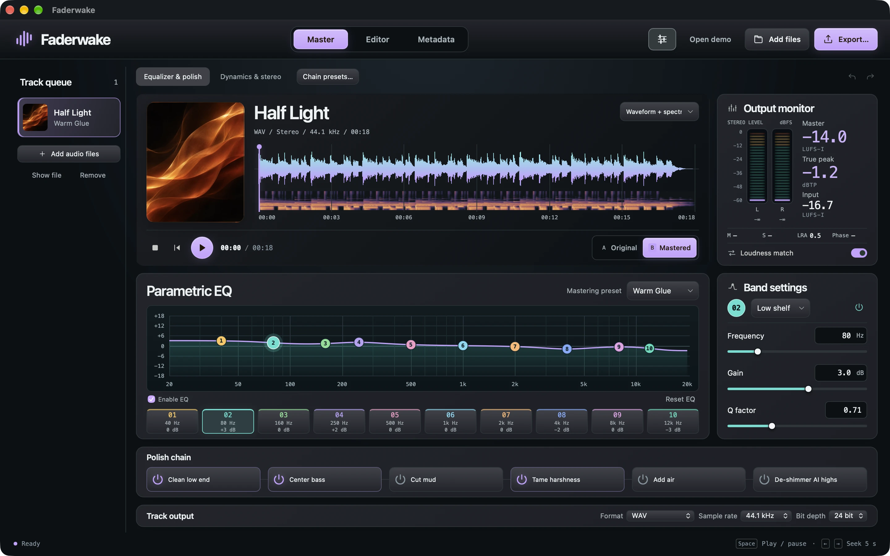
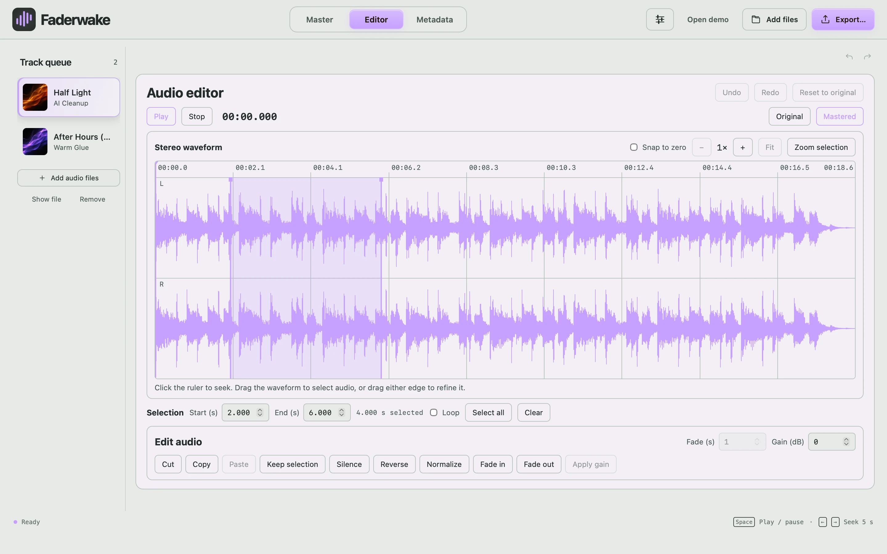

# Faderwake

Faderwake is a desktop audio mastering and waveform editor for macOS, Windows and Linux. Shape a mix with a ten-band parametric EQ, compare the original and master at matched loudness, then export individual tracks or a whole queue. Audio processing, analysis and encoding run locally.

[Download the latest release](https://github.com/SUP3RMASS1VE/Faderwake/releases/latest)



## Install Faderwake 0.1.0

| Platform | Release download | Open the app |
| --- | --- | --- |
| macOS 15 or later, Apple silicon or Intel | [Universal Mac ZIP](https://github.com/SUP3RMASS1VE/Faderwake/releases/download/v0.1.0/Faderwake-macOS-universal.zip) | Extract the ZIP, drag **Faderwake.app** to Applications and open it. |
| Windows x64 | [Portable Windows ZIP](https://github.com/SUP3RMASS1VE/Faderwake/releases/download/v0.1.0/Faderwake-Windows-x64.zip) | Extract the entire folder and open **Faderwake.exe** inside it. |
| Ubuntu 24.04, Intel or AMD 64-bit | [Linux x64 Debian package](https://github.com/SUP3RMASS1VE/Faderwake/releases/download/v0.1.0/Faderwake-Linux-x64.deb) | From the download directory, run `sudo apt install ./Faderwake-Linux-x64.deb`. |
| Ubuntu 24.04, ARM64 | [Linux ARM64 Debian package](https://github.com/SUP3RMASS1VE/Faderwake/releases/download/v0.1.0/Faderwake-Linux-ARM64.deb) | From the download directory, run `sudo apt install ./Faderwake-Linux-ARM64.deb`. |

The macOS build is ad hoc signed. If macOS asks for confirmation on first launch, Apple explains how to review the app in **System Settings → Privacy & Security**. [Apple’s guide to opening downloaded apps](https://support.apple.com/en-ie/102445)

On Windows, install the x64 Evergreen WebView2 Runtime if the app reports it is missing. The audio codecs and demo track are included in each package. [Microsoft’s WebView2 Runtime download](https://developer.microsoft.com/en-us/microsoft-edge/webview2/#download)

## Master your first track

1. Choose **Open demo** to load *Half Light* with the Warm Glue preset. For your own mix, choose **Add files** or drop the audio onto the window.
2. Press **Space** to play. Turn on **Loudness match** and switch between **A · Original** and **B · Mastered**. Click the waveform or spectrogram to jump to another passage. Loudness matching changes only the level you hear during comparison.
3. In **Master**, drag an EQ handle or use **Band settings** to enter its frequency, gain, Q and filter shape. Open **Dynamics & stereo** for the compressor, de-esser, stereo width, loudness target and true-peak ceiling.
4. Choose the format, sample rate and bit depth under **Track output**. Open **Export…** and select a single track or the entire queue. Each track keeps its own settings.

Faderwake starts with seven built-in presets. Use **Chain presets…** to save your own settings, recall a saved chain or apply it across the queue. Custom presets live in your local Faderwake library.

<details>
<summary>What the six Polish switches do</summary>

Play a passage in **B · Mastered** and toggle one switch to hear its effect. A checkmark means the stage is active in playback and export. The EQ graph follows the ten bands you can edit.

| Polish switch | What it changes |
| --- | --- |
| Clean low end | Rolls off rumble below 30 Hz. |
| Center bass | Narrows the stereo bass below 120 Hz. Bass already in the center stays in place. |
| Cut mud | Cuts 3 dB around 250 Hz. |
| Tame harshness | Softens frequencies around 4 and 6 kHz. |
| Add air | Lifts the top end with a high shelf at 12 kHz. |
| De-shimmer AI highs | Dynamically tames bright highs and rolls off the top end around 16 kHz. |

</details>

## Edit audio and file tags



Drag across the waveform in **Editor** to select a passage. Zoom into it, loop it, or snap its boundaries to zero crossings. You can cut, copy, paste, keep a selection, fade, reverse, silence, normalize or apply gain. Undo and redo let you revisit edits before export. Your source file stays intact.

In **Metadata**, edit the title, artist, album, genre, year, track number and comment. You can apply the same tags across the queue.

| Export format | Sample rates (kHz) | Resolution |
| --- | --- | --- |
| WAV, FLAC, Apple Lossless (.m4a) | 44.1, 48, 88.2, 96, 176.4, 192 | 16 or 24 bit |
| AAC (.m4a) | 44.1, 48 | 128 kb/s mono or 256 kb/s stereo |

**Preferences** includes light and dark appearances, accent colors and keyboard shortcuts. On macOS 26 or later, **Preferences → Liquid Glass** enables Apple’s native glass material for the toolbar and track queue. Faderwake respects the system’s **Reduce Transparency** setting.

## Build from source

Install stable Rust, Node.js 22 or later and the Tauri prerequisites for your platform. On macOS, use Xcode command-line tools with the macOS 26 SDK or later for Liquid Glass support. Linux needs the ALSA and WebKitGTK 4.1 development packages. On Windows, use MSYS2 UCRT64 with Make, GCC, tar and xz to build the codecs. [Tauri prerequisites](https://v2.tauri.app/start/prerequisites/) · [Desktop build workflow](.github/workflows/desktop.yml)

```sh
npm ci
npm run dev
```

The first codec build verifies the vendored FFmpeg source archive and compiles FFmpeg and ffprobe. Subsequent builds reuse them. Run these commands to test and build for the current platform.

```sh
npm run codecs
cargo test --workspace --locked --release
npm run build -- -- --locked
```

For a universal Mac app, install both Rust targets, then build the bundle and verify its signatures, architectures and codecs.

```sh
rustup target add aarch64-apple-darwin x86_64-apple-darwin
npm run build -- --target universal-apple-darwin --bundles app -- --locked
bash tools/verify-macos-bundle.sh target/universal-apple-darwin/release/bundle/macos/Faderwake.app
```

The desktop workflow also builds a Windows installer and Linux Debian and AppImage packages. Run the packaged executable with `--selftest` to render the demo, check its loudness and true peak against the Swift reference, and export and reopen all four formats. The check writes to a temporary directory and exits with a nonzero status on failure.

### Capture the macOS interface

The snapshot runner opens an isolated window with temporary demo audio. This command captures the Master, Editor and Metadata views in light and dark appearances.

```sh
APP_SNAPSHOT="/tmp/faderwake-snapshots" APP_SNAPSHOT_SIZE=1240x798 \
  APP_SNAPSHOT_THEME=studio APP_SNAPSHOT_PAGES=master,editor,metadata \
  "target/universal-apple-darwin/release/bundle/macos/Faderwake.app/Contents/MacOS/faderwake"
```

`APP_SNAPSHOT` sets the output directory. `APP_SNAPSHOT_SIZE` sets the content size in logical points. `APP_SNAPSHOT_THEME` accepts `studio`, `system`, `ocean`, `amethyst`, `forest`, `rose` or `amber`. `APP_SNAPSHOT_PAGES` accepts `empty`, `master` (or `waveform`), `dynamics`, `spectrum`, `editor`, `metadata`, `fade-in`, `fade-out`, `preferences` and `about`. The empty view is always captured. Choosing `master` includes its dynamics and spectrogram views. Omit the page filter to capture every view and palette. On macOS 26 or later, add `APP_SNAPSHOT_GLASS=1` to capture native glass with the window compositor.

### Project layout

- `crates/master-core` contains the DSP, metering, sample-rate conversion and waveform editing code.
- `src-tauri` contains playback, the queue, undo history, native dialogs and audio file handling.
- `ui` contains the interface and Canvas displays.
- `vendor` contains the FFmpeg source archive and its license. `tools/prepare-codecs.sh` builds the local codec executables.
